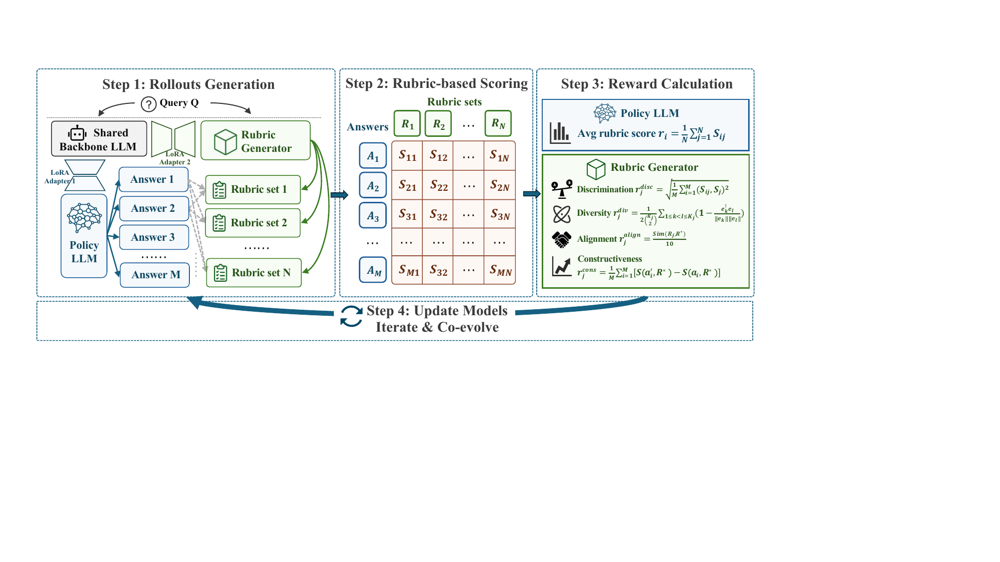

# EvoRubrics: Dynamic Rubrics as Rewards via Adversarial Co-Evolution for LLM Reinforcement Learning

Co-evolutionary reinforcement learning with a **Policy LLM** and a **Rubric Generator** that jointly improve through adversarial interaction within each training step.

## Overview

Rubric-based rewards offer interpretable and fine-grained optimization signals for reinforcement learning in open-ended tasks where verifiable answers are unavailable. However, pre-constructed rubrics remain static throughout training, creating a fundamental mismatch with the evolving policy: fixed criteria gradually lose discriminative power as the model improves, leading to reward saturation and potential hacking. Recent dynamic rubric methods partially address this but rely on external frontier models or ground-truth answers, and update rubrics only at coarse granularity.

We propose **EvoRubrics**, a co-evolutionary RL framework where a Policy LLM and a Rubric Generator jointly improve through adversarial interaction within each training step. As the policy improves under the rubric generator's guidance, the rubric generator adapts its criteria to remain discriminative and informative, enabling evaluation to track the policy in real time and naturally inducing an automatic curriculum. Experiments show that EvoRubrics consistently outperforms static and dynamic rubric baselines across benchmarks. The learned Rubric Generator further generalizes as a transferable reward model. Notably, even a fully self-supervised variant without any external supervision achieves meaningful gains, suggesting that co-evolution between generation and evaluation alone can provide sufficiently rich learning signals.

## Adversarial co-evolution (unified training step)

Both training scripts use `adversarial.training_flow=unified`: within a single step, the Policy LLM and Rubrics Generator share one base model with dual LoRA adapters, roll out answers and rubrics, compute rewards, then update both adapters.

<p align="center">
  <a href="evorubrics-framework.pdf">
    
  </a>
</p>

<p align="center"><em>Full-resolution figure: <a href="evorubrics-framework.pdf">evorubrics-framework.pdf</a></em></p>

**Policy LLM** is trained to maximize rubric scores under generated criteria. **Rubrics Generator** is trained to produce rubrics that remain discriminative (spread scores across answers), diverse, aligned with golden rubrics when enabled, and useful for reflection-based improvement.

## Repository layout

```
evorubric/
├── evorubric-main/           # Training core (trainer, rewards, dual LoRA worker)
├── evorubrics-framework.pdf  # Framework overview figure
├── rubric_guidance/          # Rubric-guided evaluation helpers
├── scripts/             # Two HealthBench training recipes
├── data/                # Bundled HealthBench open_rubrics splits
├── tools/               # Data conversion utilities
└── third_party/verl/    # Vendored verl fork — do not replace with upstream pip package
```

## Setup

1. Create a Python 3.10+ environment and install dependencies:

```bash
pip install -r requirements.txt
```

2. Copy environment template and configure your LLM judge endpoint:

```bash
cp .env.example .env
# Edit .env: DEEPSEEK_BASE_URL, DEEPSEEK_API_KEY, DEEPSEEK_MODEL
```

3. Download a base / SFT model and set `MODEL_PATH` in `.env` or export it before running scripts.

4. *(Optional)* For semantic-similarity rewards, cache the sentence-transformer model locally:

```bash
mkdir -p minilm-cache/hub
huggingface-cli download sentence-transformers/all-MiniLM-L6-v2 --cache-dir minilm-cache/hub
```

## Training modes

EvoRubrics supports two reward configurations on HealthBench, both using the same unified co-evolution training loop:

| Mode | Script | Supervision | Rubrics Generator rewards |
|------|--------|-------------|---------------------------|
| **Supervised (golden-rubric)** | `scripts/run_unified_golden.sh` | Uses dataset `ground_truth_rubrics` | similarity + reflect (on golden) + discrimination + diversity (¼ each); `reflect_use_golden_rubrics=true` |
| **Self-supervised** | `scripts/run_unified_self_supervise.sh` | No golden rubrics in the reward | reflect + discrimination + diversity (⅓ each); generated rubrics score baseline/revised answers (`reflect_use_golden_rubrics=false`) |

In **supervised** mode, the Rubrics Generator is guided toward human- or teacher-provided golden criteria (similarity to golden rubrics and reflect scored on golden rubrics). In **self-supervised** mode, all Rubrics Generator reward terms come from co-evolution alone—discrimination, diversity, and reflect use only the model’s own generated rubrics—so no external rubric labels are required during training.

Both scripts still need an **LLM judge** (OpenAI-compatible API) to score answers against rubrics; self-supervised mode removes dependence on **golden rubric annotations** in the training reward, not on the judge itself.

## Training scripts

Example (supervised):

```bash
export MODEL_PATH=/path/to/your/sft-model
export CUDA_VISIBLE_DEVICES=0,1
export N_GPUS_PER_NODE=2
bash scripts/run_unified_golden.sh
```

Example (self-supervised):

```bash
export MODEL_PATH=/path/to/your/sft-model
export CUDA_VISIBLE_DEVICES=0,1,2,3
export N_GPUS_PER_NODE=4
bash scripts/run_unified_self_supervise.sh
```

Key environment variables are documented at the top of each script. Checkpoints and logs are written under `checkpoints/` and `training_logs/` (gitignored).

## Data

| File | Description |
|------|-------------|
| `data/healthbench_train_easy_4k.json` | Training split (open_rubrics format) |
| `data/healthbench_official_hard_1k.json` | Evaluation split (open_rubrics format) |

To regenerate the evaluation split from upstream HealthBench sources, see `tools/convert_deepseek_split_to_open_rubrics.py`.

## LLM judge

Training uses an OpenAI-compatible API for rubric scoring (`evorubric-main/llm_evaluator.py`). Configure via `.env`:

- `DEEPSEEK_BASE_URL` — e.g. a local vLLM gateway at `http://127.0.0.1:8000/v1`
- `DEEPSEEK_API_KEY` — use `EMPTY` for local servers that do not require auth
- `DEEPSEEK_MODEL` — model name served by your gateway

## Acknowledgements

This project builds on and benefits from the following open-source efforts:

- [**verl**](https://github.com/volcengine/verl) — distributed RL training framework (vendored in `third_party/verl/`)
- [**vLLM**](https://github.com/vllm-project/vllm) — high-throughput LLM inference for rollout and LLM-judge serving
- [**HealthBench**](https://github.com/openai/simple-evals) — medical QA benchmark and rubric-based evaluation protocol used for training and evaluation data

## License

MIT License — see [LICENSE](LICENSE). This repository vendors [verl](https://github.com/volcengine/verl) under Apache-2.0 in `third_party/verl/`.
